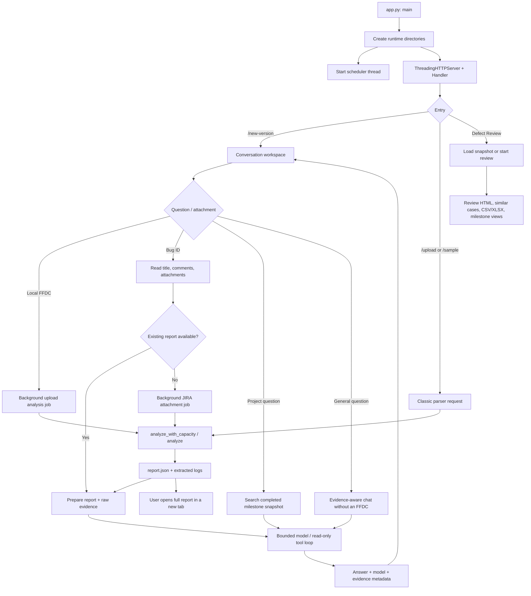
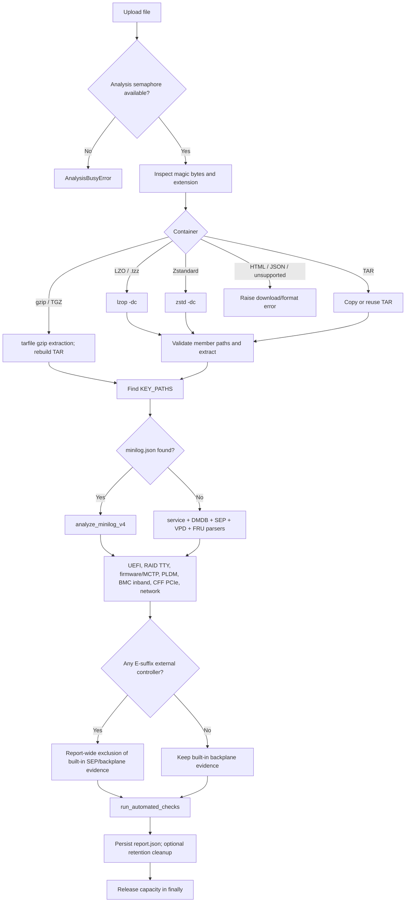
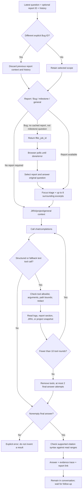
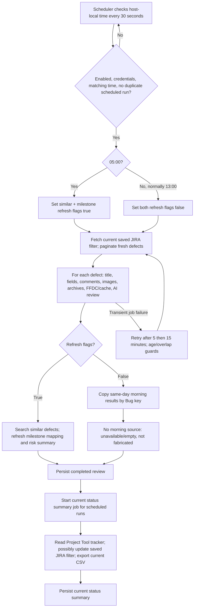
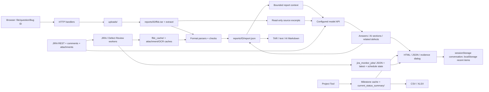

# FFDC Analyzer: Program Logic

## Architecture

This is a Python standard-library HTTP application with a deterministic FFDC parser, evidence-reading tools, several AI request paths, file-backed reports/jobs, and two browser presentations. It is **not** a replacement of all parsers with a model, and it is not an unrestricted shell-executing agent.

| Layer | Source | Responsibility |
| --- | --- | --- |
| HTTP and orchestration | `app.py`, `Handler`, `main` | Routes, upload jobs, JIRA integration, scheduled review, parser pipeline, report rendering, persistence. |
| Conversation and tools | `ffdc_chat.py`, `EvidenceTools`, `run_chat` | Read-only log/JIRA/project tool schemas, bounds, redaction, model/tool loop. |
| Focused evidence preparation | `workspace_analysis.py`, `WorkspaceEvidenceTools` | Component focus, diverse raw excerpts, parsed section pagination, citation-range verification. |
| New visual shell | `workspace_ui.py` | New conversation page, shared navigation, opt-in themed classic subpages. |
| Browser behavior | `static/workspace.js` | Session state, upload/job polling, conversational replies, evidence dialog, report link, safe Markdown token rendering. |
| Existing report UI | `app.py` rendering functions; `static/workspace-subpage.*` | Detailed inventories/checks/evidence, Defect Review and milestone views; `view=workspace` preserves their shared visual shell. |

The following diagrams describe observable execution and data movement, not private model reasoning.

## Overall Execution

## FFDC Parsing Decisions

Sources: `app.py:1578-1636`, `1670-1715`, `10164-10244`. Unsupported extensions are not accepted as valid merely because the browser permits choosing a file. Standard FFDC extraction and separately bounded JIRA log-archive extraction are different code paths.

**Scope caveat:** the current external-controller decision is report-wide. On a machine with both internal and external controllers, detecting any E-suffix controller suppresses built-in backplane data for the whole report. This is broader than per-controller filtering and is explicitly recorded as a limitation.

## Conversation and Tool Loop

`run_chat` caps each model tool batch at four calls; calls in a batch are executed sequentially. A workspace time check is made before requests once 210 seconds have elapsed; this is not a hard preemptive deadline for a request already in flight. The browser stops waiting after 12 minutes. Stopping waiting does not cancel a server parser thread.

### Evidence Rules

1. Original log observations cite relative path and line/range.
2. Parser/automated findings cite a parsed report section and are not automatically root-cause proof.
3. JIRA title, description, engineer comments, screenshot interpretation, and log evidence remain distinguishable sources.
4. Narrow scans and empty matches cannot establish absence of faults. Recovery and timestamps must be considered.
5. The workspace's citation validator checks a particular backtick-delimited `path:line` syntax and read ranges. It does not prove that the interpretation is correct or detect every possible citation format.
6. General answers may use model knowledge. The supplied tools cannot execute commands, inspect a live test machine, or search the public web.

## Scheduled Review

**Important implementation distinction:** the main 13:00 review reuses morning similar cases and milestone mapping. However, `run_jira_monitor_job` starts `run_current_status_summary_job` after any completed scheduled run, and that summary function calls `fetch_current_tracker_projects`. Therefore the inspected local source does **not** guarantee that the complete 13:00 pipeline avoids Project Tool refreshes. This is a documented discrepancy, not a change made by this documentation task.

New defects meeting the filter are fetched at 13:00. If they did not exist in the morning result, no morning similar-case or per-defect milestone mapping exists to copy. Manual review defaults to full refresh. Startup can also request a full run when scheduling is enabled and no latest job exists. Times are configurable, but full-refresh selection explicitly tests `05:00`, not simply the first configured time.

## ETL and Data Movement

AI prompts leave the application server for the configured API service. A server-side token prevents browser exposure; it does not imply that report evidence stays on the local server. JIRA comment submission is a separate, user-credentialed write route. Current status summary generation can also modify the saved JIRA filter with its configured account.

## Decisions and Entry Points

| Function / location | Condition | Result |
| --- | --- | --- |
| `unpack_ffdc`, `app.py:1608` | Magic bytes / suffix | LZO, Zstandard, gzip, TAR, or explicit failure. |
| `analyze`, `app.py:10164` | `files['minilog']` exists | V4 parser vs classic V1/V3 parser. |
| `classify_backplane_scope`, `app.py:1679` | Any external model regex match | Suppress built-in backplane evidence report-wide. |
| `workspace_question_requests_ffdc_analysis`, `app.py:11228` | Bug key and no milestone/countdown phrase | Retrieve or reuse FFDC context. |
| `workspace_chat_response`, `app.py:11444` | New explicit Bug differs from current report | Drop old context/history; avoid cross-Bug contamination. |
| `run_jira_analysis_job`, `app.py:4875` | No supported FFDC source | Produce a JIRA attachment/context report rather than assert an FFDC exists. |
| `jira_image_comment`, `app.py:6918` | Cached body, vision success, OCR success | Reuse cache; otherwise vision then OCR; return empty evidence if neither works. |
| `search_similar_jira_cases`, `app.py:6196` | Specific title terms available | Narrow title JQL; otherwise signature search; optional PSoC expansion for model assessment. |
| `davy_rank_similar_jira_cases`, `app.py:6152` | Complete response after at most 2 attempts | Preserve assessment; otherwise record an error and retain deterministic candidates. |
| `start_scheduled_jira_monitor_job`, `app.py:8397` | Trigger/time includes `05:00` | Full refresh; ordinary afternoon scheduled run reuses morning flags/results. |
| `run_current_status_summary_job`, `app.py:6625` | New valid Project Tool IDs | Update saved JIRA filter, then export current fields. |
| `run_chat`, `ffdc_chat.py:414` | Tool rounds exhausted | No-tool synthesis attempts, then explicit failure. |

The generated entry-point index below includes auxiliary executables. Do not run historical or one-off scripts merely to start the web product.

<!-- GENERATED ENTRY POINTS -->

## Complete Root Python Entrypoint Index

| File | Role | Entry mechanism | Source |
| --- | --- | --- | --- |
| app.py | current service | main guard at 14487 | [app.py:14487](../app.py#L14487) |
| app.py.agentwork | historical copy; do not deploy | main guard at 4782 | [app.py.agentwork:4782](../app.py.agentwork#L4782) |
| app.py.ai_work | historical copy; do not deploy | main guard at 9403 | [app.py.ai_work:9403](../app.py.ai_work#L9403) |
| app.py.correlationwork | historical copy; do not deploy | main guard at 4936 | [app.py.correlationwork:4936](../app.py.correlationwork#L4936) |
| app.py.defect_tags_work | historical copy; do not deploy | main guard at 10128 | [app.py.defect_tags_work:10128](../app.py.defect_tags_work#L10128) |
| app.py.jira_monitor | historical copy; do not deploy | main guard at 8477 | [app.py.jira_monitor:8477](../app.py.jira_monitor#L8477) |
| app.py.remote | historical copy; do not deploy | main guard at 9248 | [app.py.remote:9248](../app.py.remote#L9248) |
| app.py.riser_work | historical copy; do not deploy | main guard at 9341 | [app.py.riser_work:9341](../app.py.riser_work#L9341) |
| app.py.ueficlean | historical copy; do not deploy | main guard at 4936 | [app.py.ueficlean:4936](../app.py.ueficlean#L4936) |
| compare_ioss8312_dmesg.py | support/diagnostic script | Top-level statements execute on import/run | [compare_ioss8312_dmesg.py:23](../compare_ioss8312_dmesg.py#L23) |
| compare_uefi_bay_paths.py | support/diagnostic script | Top-level statements execute on import/run | [compare_uefi_bay_paths.py:29](../compare_uefi_bay_paths.py#L29) |
| compare_vmd_current_values.py | support/diagnostic script | Top-level statements execute on import/run | [compare_vmd_current_values.py:24](../compare_vmd_current_values.py#L24) |
| compare_vroc_compact.py | support/diagnostic script | Top-level statements execute on import/run | [compare_vroc_compact.py:33](../compare_vroc_compact.py#L33) |
| compare_vroc_focus.py | support/diagnostic script | Top-level statements execute on import/run | [compare_vroc_focus.py:24](../compare_vroc_focus.py#L24) |
| compare_vroc_slot89.py | support/diagnostic script | Top-level statements execute on import/run | [compare_vroc_slot89.py:22](../compare_vroc_slot89.py#L22) |
| deep_compare_vmd.py | support/diagnostic script | Top-level statements execute on import/run | [deep_compare_vmd.py:20](../deep_compare_vmd.py#L20) |
| domain_documents.py | support/diagnostic script | main guard at 182 | [domain_documents.py:182](../domain_documents.py#L182) |
| extract_ioss8312.py | support/diagnostic script | Top-level statements execute on import/run | [extract_ioss8312.py:10](../extract_ioss8312.py#L10) |
| focused_uefi_vmd_evidence.py | support/diagnostic script | Top-level statements execute on import/run | [focused_uefi_vmd_evidence.py:34](../focused_uefi_vmd_evidence.py#L34) |
| inspect_bay191.py | support/diagnostic script | Top-level statements execute on import/run | [inspect_bay191.py:5](../inspect_bay191.py#L5) |
| inspect_bios_vmd.py | support/diagnostic script | Top-level statements execute on import/run | [inspect_bios_vmd.py:25](../inspect_bios_vmd.py#L25) |
| inspect_ioss8312.py | support/diagnostic script | Top-level statements execute on import/run | [inspect_ioss8312.py:7](../inspect_ioss8312.py#L7) |
| inspect_vmd_values.py | support/diagnostic script | Top-level statements execute on import/run | [inspect_vmd_values.py:5](../inspect_vmd_values.py#L5) |
| map_ioss8312_failures.py | support/diagnostic script | Top-level statements execute on import/run | [map_ioss8312_failures.py:9](../map_ioss8312_failures.py#L9) |
| patch_defect_review_brand_link.py | support/diagnostic script | Top-level statements execute on import/run | [patch_defect_review_brand_link.py:14](../patch_defect_review_brand_link.py#L14) |
| patch_jira_attachment_ocr.py | support/diagnostic script | Top-level statements execute on import/run | [patch_jira_attachment_ocr.py:304](../patch_jira_attachment_ocr.py#L304) |
| summarize_ioss8312.py | support/diagnostic script | Top-level statements execute on import/run | [summarize_ioss8312.py:30](../summarize_ioss8312.py#L30) |
| summarize_ioss8312_snapdumps.py | support/diagnostic script | Top-level statements execute on import/run | [summarize_ioss8312_snapdumps.py:8](../summarize_ioss8312_snapdumps.py#L8) |
| test_domain_authoring.py | test suite | main guard at 258 | [test_domain_authoring.py:258](../test_domain_authoring.py#L258) |
| test_domain_packs.py | test suite | main guard at 56 | [test_domain_packs.py:56](../test_domain_packs.py#L56) |
| test_ffdc_chat.py | test suite | main guard at 316 | [test_ffdc_chat.py:316](../test_ffdc_chat.py#L316) |
| test_ffdc_config.py | test suite | main guard at 30 | [test_ffdc_config.py:30](../test_ffdc_config.py#L30) |
| test_ffdc_jobs.py | test suite | main guard at 42 | [test_ffdc_jobs.py:42](../test_ffdc_jobs.py#L42) |
| test_jira_monitor_workflow.py | test suite | main guard at 169 | [test_jira_monitor_workflow.py:169](../test_jira_monitor_workflow.py#L169) |
| test_jira_report_collection.py | test suite | main guard at 89 | [test_jira_report_collection.py:89](../test_jira_report_collection.py#L89) |
| test_jira_results_restore.py | test suite | main guard at 39 | [test_jira_results_restore.py:39](../test_jira_results_restore.py#L39) |
| test_workspace_jira_auth.py | test suite | main guard at 91 | [test_workspace_jira_auth.py:91](../test_workspace_jira_auth.py#L91) |
| test_workspace_quality.py | test suite | main guard at 189 | [test_workspace_quality.py:189](../test_workspace_quality.py#L189) |
| test_workspace_ui.py | test suite | main guard at 393 | [test_workspace_ui.py:393](../test_workspace_ui.py#L393) |
| v4_batch_validate.py | support/diagnostic script | main guard at 168 | [v4_batch_validate.py:168](../v4_batch_validate.py#L168) |
| vision_capability_test.py | support/diagnostic script | Top-level statements execute on import/run | [vision_capability_test.py:4](../vision_capability_test.py#L4) |

No `.bat` or shell launch script exists at the project root in this snapshot. The deployment unit is external, not a checked-in executable entrypoint.

See Specification for persistence destinations and AuditInventory for every root file and ancillary artifact.
